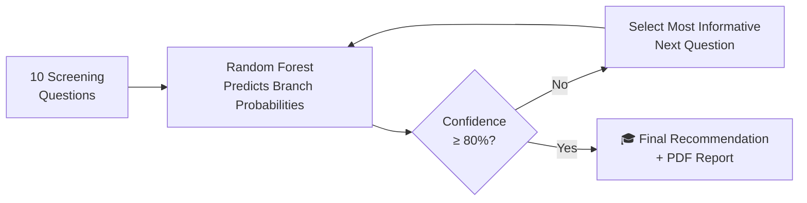

<div align="center">

# 🧭 BranchFit

### *Answer less. Learn more. Find the engineering branch that fits you.*

An adaptive, ML-powered questionnaire that recommends the right engineering branch, choosing each next question based on your previous answers.

<br>


[🚀 **Live Demo**](https://branchfit1.onrender.com/) · [📖 Setup Guide](SETUP_INSTRUCTIONS.md) · [🐛 Report Bug](../../issues)

<br>


</div>

---

## ✨ Highlights

| | Feature | Description |
|---|---|---|
| 🧠 | **Adaptive Questioning** | Every answer reshapes the next question using information gain and uncertainty sampling |
| 🎯 | **Two Test Modes** | A general test across all branches, or a focused suitability test for one branch |
| ⚡ | **Early Stopping** | Ends as soon as the model reaches 80% confidence, with no filler questions |
| 📄 | **PDF Reports** | Download your results and top recommendations |
| 📊 | **History & Admin Analytics** | Track past tests, with an admin dashboard for aggregate insights |
| 🔐 | **Secure Accounts** | Registration, login and hashed passwords backed by MongoDB Atlas |

---

## 🧬 How It Works



1. **Screen**: 10 initial Likert-scale questions (1–5).
2. **Predict**: a Random Forest returns a probability for each of 5 branches.
3. **Adapt**: `TrueAdaptiveSystem` ranks the remaining question pool by expected information gain.
4. **Conclude**: the test stops at the confidence threshold or the question cap.

### 🎓 Branches Covered
`Computer Engineering` · `EXTC` · `Electrical` · `Information Technology / CSE` · `Mechanical`

---

## 🤖 The Model

| | |
|---|---|
| **Algorithm** | Random Forest Classifier (100 trees) |
| **Preprocessing** | StandardScaler |
| **Dataset** | 1,000 balanced, augmented responses (200 per branch) |
| **Features** | 60 Likert-scale questions |
| **Accuracy** | `<XX>%` ← update from `retrain_model.py` |

---

## 🛠️ Tech Stack

<table>
<tr><td><b>Backend</b></td><td>Python · Flask · Flask-Login · Flask-WTF</td></tr>
<tr><td><b>Machine Learning</b></td><td>scikit-learn · NumPy · pandas · joblib</td></tr>
<tr><td><b>Database</b></td><td>MongoDB Atlas (PyMongo)</td></tr>
<tr><td><b>Reports</b></td><td>ReportLab</td></tr>
<tr><td><b>Frontend</b></td><td>Jinja2 · Bootstrap · Font Awesome</td></tr>
<tr><td><b>Deployment</b></td><td>Gunicorn · Render</td></tr>
</table>

---

## 🚀 Getting Started

```bash
# 1. Clone
git clone <repo-url> && cd "branch fit"

# 2. Install
pip install -r requirements.txt

# 3. Configure
cp .env.example .env

# 4. Run
python app.py        # → http://localhost:5000
```

<details>
<summary><b>⚙️ Environment variables</b></summary>

```env
SECRET_KEY=your_secret_key
MONGO_URI=your_mongodb_atlas_uri
ADMIN_USERNAME=your_admin_user
ADMIN_PASSWORD=your_admin_password
```
</details>

<details>
<summary><b>🔁 Retrain the model</b></summary>

```bash
python retrain_model.py
```
</details>

---

## 📁 Project Structure

```
branch-fit/
├── app.py                       # Routes: auth, tests, results, admin
├── adaptive_system_v2.py        # Adaptive question engine
├── retrain_model.py             # Training pipeline
├── balanced_dataset_augmented.csv
├── branchfit_questions_final.xlsx
├── adaptive_questions.json
├── model.pkl · scaler.pkl
└── templates/ · static/
```

---

## 🗺️ Roadmap
- [ ] Persist test sessions in MongoDB
- [ ] Train on real student responses
- [ ] Explainability: show *why* a branch was recommended

---

<div align="center">

**Built by [Vaibhavi Rai](https://github.com/vaiii05)** · ⭐ Star this repo if it helped you!

</div>
